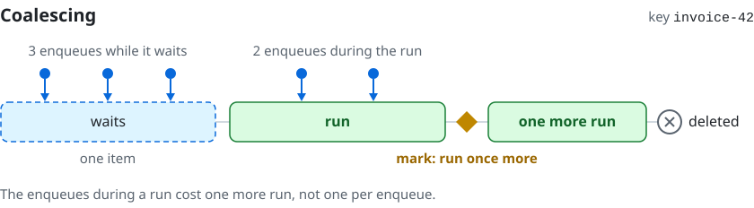
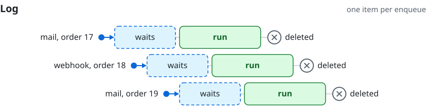
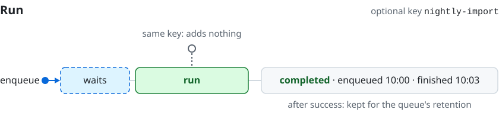

# Moltaro.Work

Durable background work for .NET on PostgreSQL, SQL Server and MySQL: enqueue in your own
transaction, coalesce work per key, claim with leases and fencing, retry with backoff and
dead items, clean up by retention, wake at once with
[Moltaro.Signals](https://github.com/andrton/Moltaro.Signals).

## Status

Contract stage. The [concept](docs/concept.md) is agreed. The core package `Moltaro.Work`
exists as its public contract, documented: its types check their arguments and options,
`WorkClient.Join` and `WorkTransaction.EnqueueAsync` hand a checked enqueue to the provider,
and every other entry point throws `NotSupportedException`. The providers
`Moltaro.Work.PostgreSql`, `Moltaro.Work.SqlServer` and `Moltaro.Work.MySql` exist as their
contracts and their schema scripts of version 1, which [storage](docs/storage.md) describes.
Each script creates the tables on its database: PostgreSQL 15, SQL Server 2019 or MySQL 8.4, or
later. Each store checks its data source and refuses the transaction of an enqueue on another
database; every one of its operations throws `NotSupportedException`. Nothing below works today.
The first epic, the library up to its first release, is planned in
[current work](docs/work/README.md); its first stage is the public .NET contract.

## What it is, and what it is not

An application keeps its background work in its own database: jobs to run, messages to
deliver, records to recompute. With this library it declares a queue, enqueues items in the
same transaction as the write that creates them, and writes a handler. The library does the
rest:

- an item exists if and only if the business write commits;
- items come in [three shapes](#the-three-shapes):
  - coalescing: one item per key, however often it is enqueued;
  - log: every item counts;
  - run: kept with its outcome for its history;
- workers claim items in batches under a lease, and a holder whose lease was reclaimed
  cannot complete the item;
- a handler runs at least once and may run again for the same item, for example after a
  lost lease, so handlers are written to be idempotent;
- failures are retried with a backoff and given up after a limit, with the reason kept;
- every queue cleans up after itself;
- workers wake through Moltaro.Signals when work is committed and at the earliest due
  time, never on a polling interval.

It is not a message broker, a scheduler of cron expressions, a workflow engine or a
dashboard. See the [concept](docs/concept.md#7-non-goals-and-possible-later-work) for the
full list of non-goals.

## The three shapes

Every queue has one of three shapes. All three share one mechanism: retries with a backoff,
dead items, leases and retention. They differ in what an item means, what a second enqueue
does, and what remains after success.

### Coalescing: "this object needs attention"

A coalescing queue holds one item per key, and the key names an object of the application.
The item carries no payload: its handler reads the object's current state.

<picture>
  <source media="(prefers-color-scheme: dark)" srcset="docs/images/coalescing-dark.svg">
  
</picture>

For example, the key `invoice-42` means "recompute the totals of invoice 42". Changes made
while the item waits leave that one item. Changes made while it runs add one more run, not
one per change. So the changes made during one run cost one more run, however many they
are, and the last run reads the latest state.

An enqueue that names no due time is due at once, and a worker starts on it right away. An
application that wants a burst collected names a due time, for example a second ahead:
every enqueue within that second then finds the item waiting, and the run starts once, on
the latest state.

- **An enqueue while the item waits** adds nothing, and the item's due time becomes the
  earlier of the two. The exception is an item that waits for a retry: it keeps its due
  time, so that its backoff holds.
- **An enqueue while the handler runs** marks the item to run once more after the current
  run, because the handler may have read the state before that change. Any number of
  changes during a run add one mark: one more run, not one per change, and none is lost.
- **After success** the item is deleted, unless it is marked to run once more.
- **A dead item** is revived by the next enqueue, with its attempts counted from zero. After
  a fix, the next change of the object processes it again.

### Log: "here is an event, handle each one"

A log queue holds one item per enqueue, with a payload that the application serializes.
For example: "send the confirmation mail of order 17", "notify the webhook of order 18".
Every event must be handled, so every event becomes its own item.

<picture>
  <source media="(prefers-color-scheme: dark)" srcset="docs/images/log-dark.svg">
  
</picture>

- **After success** the item is deleted.
- **An optional key** guards against duplicates: while an item with that key is active,
  waiting or running, an enqueue with the same key adds nothing. A business transaction
  that is retried while its first mail still waits then adds no second mail.

### Run: "an operation whose history matters"

A run queue holds, like a log, one item per enqueue, with a payload. The difference is what
remains: after success a run is kept, with its status, attempts, times and last error, for
the queue's retention, so that an application can show its history. For example: "import
of file X: enqueued 10:00, 2 attempts, finished 10:03".

<picture>
  <source media="(prefers-color-scheme: dark)" srcset="docs/images/run-dark.svg">
  
</picture>

- **An optional key** keeps two runs with that key from being active at once. With the key
  `nightly-import`, an enqueue of a second import adds nothing while one waits or runs;
  once that run ends, the key is free again.

### Side by side

| | Coalescing | Log | Run |
| --- | --- | --- | --- |
| **What an item means** | An object that needs attention | An event to handle | An operation whose history matters |
| **Payload** | None; the handler reads the current state | Yes | Yes |
| **A second enqueue while the first waits** | Adds nothing; the due time becomes the earlier of the two, unless it waits for a retry | A new item; with a key, nothing | A new item; with a key, nothing |
| **An enqueue while the handler runs** | One mark: one more run after this one, not one per enqueue | A new item; with a key, nothing | A new item; with a key, nothing |
| **After success** | Deleted, unless marked to run once more | Deleted | Kept with its outcome for the queue's retention |

### Which one to choose

- To bring an object to its current state, when the changes in between do not matter:
  **coalescing**.
- When every event must be handled and no history is needed: **log**.
- When someone needs to see what ran and how it ended: **run**.

## Packages (planned)

| Package | Contents |
| --- | --- |
| `Moltaro.Work` | The database-neutral core |
| `Moltaro.Work.PostgreSql` | The PostgreSQL provider |
| `Moltaro.Work.SqlServer` | The SQL Server provider |
| `Moltaro.Work.MySql` | The MySQL provider |
| `Moltaro.Work.Hosting` | Registration in a .NET generic host |

They will be published on [nuget.org](https://www.nuget.org) by the
[Publish](.github/workflows/publish.yml) workflow when a version tag is pushed. Nothing is
published yet. [Branches and releases](docs/work/branches.md) describes how work reaches
`main` and how a version is released.

## Documentation

- [Concept](docs/concept.md): where it comes from, shapes and rules, providers, decisions
  and quality bar.
- [Storage](docs/storage.md): the provider contract and the schemas of PostgreSQL, SQL Server
  and MySQL.
- [Documentation index](docs/README.md) and [current work](docs/work/README.md).
- [How the project is built](AGENTS.md): architectural principles, code style and working
  rules, for people and coding agents.

## Building

Requires the [.NET 10 SDK](https://dotnet.microsoft.com/download). Run the commands
from the `src` directory.

```bash
dotnet build
```

```bash
dotnet test
```

The tests of each provider need its database: `MOLTARO_WORK_POSTGRESQL` holds a connection
string to PostgreSQL 15 or later, `MOLTARO_WORK_SQLSERVER` to SQL Server 2019 or later, and
`MOLTARO_WORK_MYSQL` to MySQL 8.4 or later. Each is used as a server where each run creates a
database of its own and drops it at the end; without its variable, the tests of that provider
fail. The samples, run with `dotnet run --project Moltaro.Work.Samples`, use
`MOLTARO_WORK_POSTGRESQL` as a database where they create their tables and leave them.

## License

[Apache License 2.0](LICENSE)
